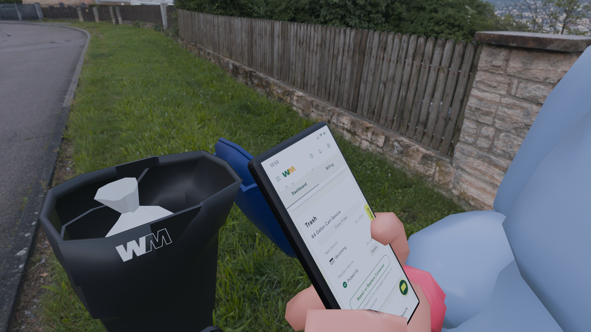
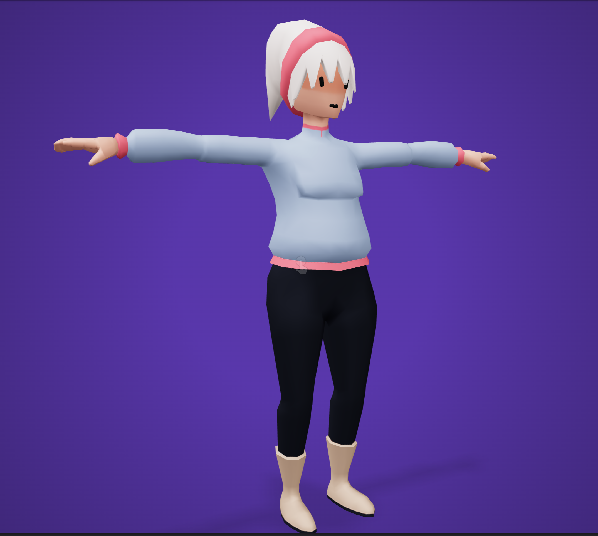
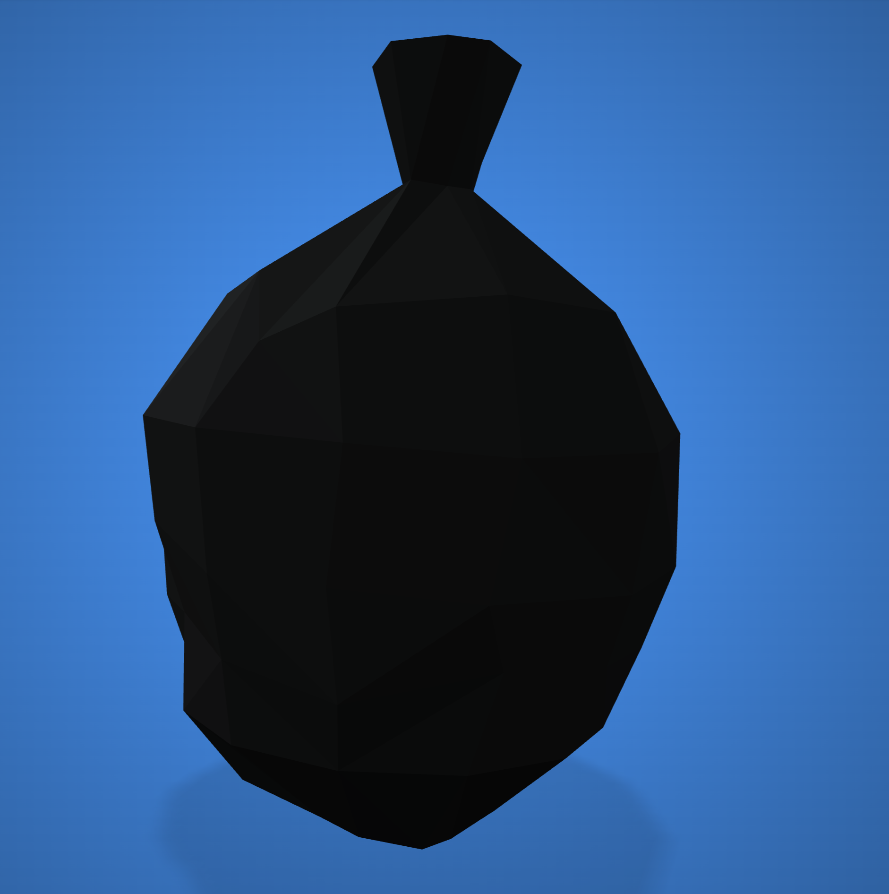
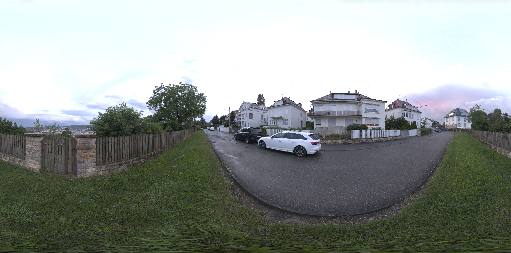

# WM Context Prototype — Checking Pickup Status at the Curb

A Blender context prototype for my WM (Waste Management) website redesign project. The scene shows the moment a resident would actually use the redesigned dashboard: standing next to a full trash bin at the curb, checking on their phone whether the pickup has happened.

---

## 1. Context Photos

Photos I took of the real situation, used as reference for the scene.

<!-- Add a short caption under each photo: where/when it was taken and what it shows. -->

---

## 2. Scenario

**Who:** A residential WM customer.

**Situation:** It is pickup day, but the bin is still full at the curb.

**Need:** The resident wants to know right away whether the pickup was missed, delayed, or is still on the way, and what to do next.

**Action:** Standing next to the bin, they open the WM website on their phone and check the pickup status on the account dashboard.

<!-- Edit or expand this with your own scenario wording. -->

---

## 3. Final Render

---

## 4. Process

### 4.1 Trash bin
- Downloaded a low-poly trash bin model from [Low Poly Pizza](https://poly.pizza).
- Changed the bin colors to match WM's bins.
- Added the WM logo to the front of the bin.
- Inset the edges of the bin to give the walls thickness. 

### 4.2 Trash bag and character
- Downloaded a trash bag model and a low-poly character model.
- Uploaded the character to [Mixamo](https://www.mixamo.com) to add a skeleton (rig) so the body and fingers could be posed.

### 4.3 Phone
- Modeled the phone from a cube in Blender.
- Rounded the edges with a Bevel modifier.
- Created a separate material for the screen only and placed a screenshot of the WM dashboard on it (Image Texture + Emission so the screen looks lit).
- Parented the phone to the character's hand so it moves with the hand.

### 4.4 Posing the hand
- In Pose Mode, rotated the finger bones so the character holds the phone: thumb on the screen, other fingers wrapped behind the phone.

### 4.5 Environment and camera
- Added an HDRI from [Poly Haven](https://polyhaven.com) as the World background to place the scene on a residential street.
- Rotated the HDRI with a Mapping node so the background sits behind the character and the bin.
- Positioned the camera using Camera to View, then rendered the final image.

---

## 5. Reflection

The downloaded character's fingers were not built for detailed posing, so even after adjusting the finger bones, the grip on the phone still looks unnatural. I am not fully satisfied with the hand in the final result.

---

## Credits

- Trash bin: Trashcan by Quaternius via Poly Pizza
- Trash bag: black by Jens Kull [CC-BY] via Poly Pizza
- Woman:  by Polygonal Mind via Poly Pizza
- Rigging: [Mixamo](https://www.mixamo.com)
- HDRI: Stuttgart Suburbs, [Poly Haven](https://polyhaven.com) (CC0)
