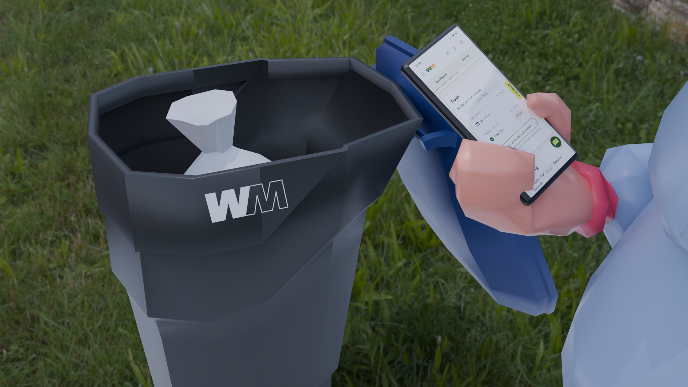
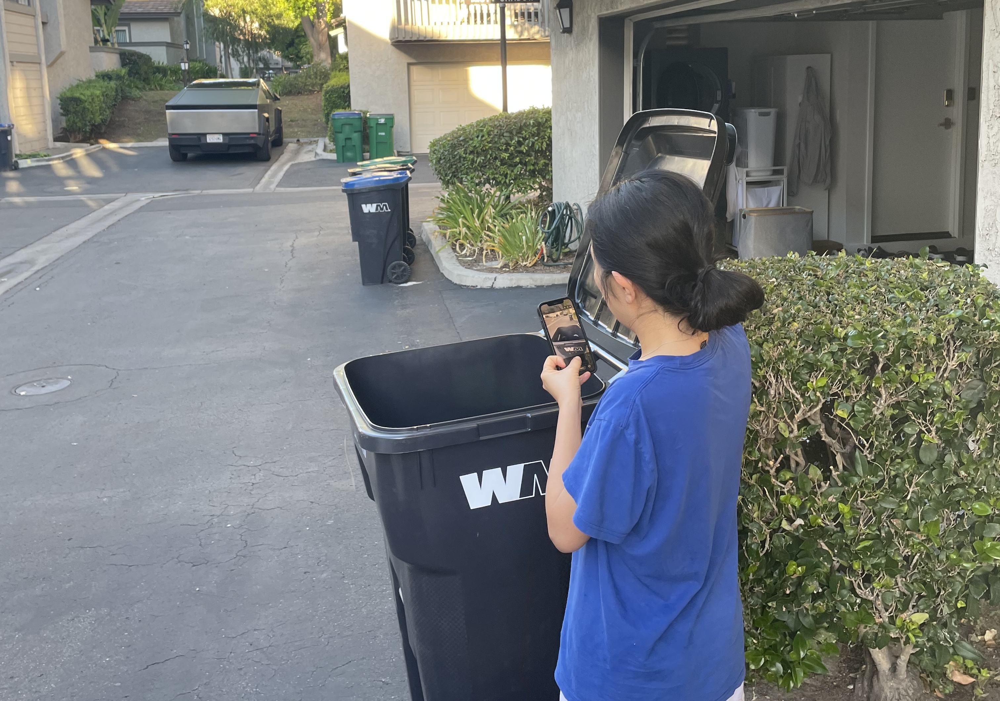
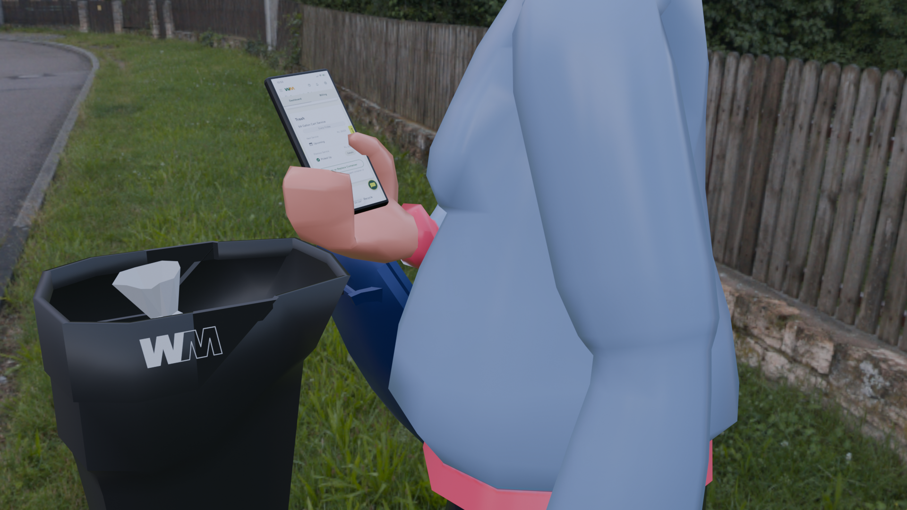
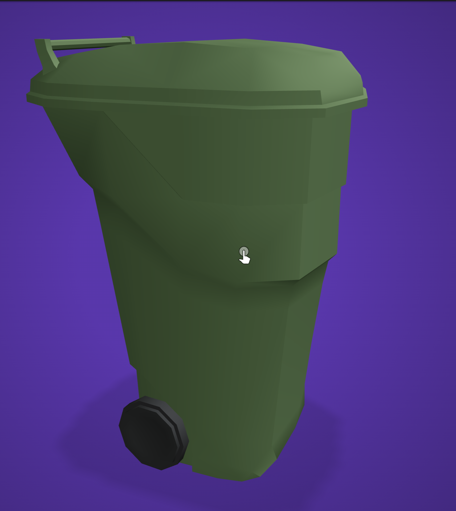

# WM Context Prototype — Checking Pickup Status at the Curb

A Blender context prototype for my WM (Waste Management) website redesign project. The scene shows the moment a resident would actually use the redesigned dashboard: standing next to a full trash bin at the curb, checking on their phone whether the pickup has happened.

---

## Update — October 27

**New this week:** a camera animation, a revised render based on class feedback, and shadows that ground the scene.

### Camera animation

The camera starts close on the full bin (the problem), then pulls back to reveal the resident checking the pickup status on their phone (the action).

<!-- On github.com, open this README in the editor, put the cursor on the empty line below, and drag the .mp4 file in. GitHub will upload it and insert a link that plays as a video. Free accounts: keep the file under 10 MB (export at 720p in QuickTime if needed). -->

### Before and after feedback

| Before | After |
| --- | --- |
|  |  |
| Phone held upright, no ground shadows | Phone tilted back to a natural holding angle, shadows on the ground |

<!-- Replace images/wm_prototype_v2.png with your new render's file name. -->

### What changed
- Tilted the phone back, following feedback that the angle mattered more than the finger details ([5.6](#56-revisions-after-feedback)).
- Added a Shadow Catcher so the bin and character no longer look like they float ([5.7](#57-grounding-the-scene-with-shadows)).
- Animated the camera from the bin to the resident ([5.8](#58-camera-animation)).
- Added a reflection on why this scenario supports a responsive, mobile-first website ([6](#6-reflection)).

---

## 1. Context Photos

Photos I took of the real situation, used as reference for the scene.

<!-- Add a short caption under each photo: where/when it was taken and what it shows. -->

---

## 2. Scenario

**Who:** A residential WM customer.

**Situation:** It is pickup day, but the bin is still full at the curb.

**Need:** The resident wants to know right away whether the pickup was missed, delayed, or is still on the way, and what to do next.

**Action:** Standing next to the bin, they open the WM website on their phone and check the pickup status on the account dashboard.

<!-- Edit or expand this with your own scenario wording. -->

---

## 3. First Render (Version 1)

---

## 4. Version 2

See the [Update](#update--october-27) section at the top for the animation and the revised render.

---

## 5. Process

### 5.1 Trash bin
- Downloaded a low-poly trash bin model from [Low Poly Pizza](https://poly.pizza).
- Changed the bin colors to match WM's bins.
- Added the WM logo to the front of the bin.
- Inset the edges of the bin to give the walls thickness. 

### 5.2 Trash bag and character
- Downloaded a trash bag model and a low-poly character model.
- Uploaded the character to [Mixamo](https://www.mixamo.com) to add a skeleton (rig) so the body and fingers could be posed.

### 5.3 Phone
- Modeled the phone from a cube in Blender.
- Rounded the edges with a Bevel modifier.
- Created a separate material for the screen only and placed a screenshot of the WM dashboard on it (Image Texture + Emission so the screen looks lit).
- Parented the phone to the character's hand so it moves with the hand.

### 5.4 Posing the hand
- In Pose Mode, rotated the finger bones so the character holds the phone: thumb on the screen, other fingers wrapped behind the phone.

### 5.5 Environment and camera
- Added an HDRI from [Poly Haven](https://polyhaven.com) as the World background to place the scene on a residential street.
- Rotated the HDRI with a Mapping node so the background sits behind the character and the bin.
- Positioned the camera using Camera to View, then rendered the final image.

### 5.6 Revisions after feedback
- Tilted the phone back to a flatter angle so it reads as being held in the hand, instead of standing upright.
- Froze the character in its phone-holding pose: the Mixamo animation moved the arm away on other frames, so I copied the pose from the frame I wanted, cleared the animation data, and pasted the pose back. The pose now stays the same for the whole shot.
- Fixed the phone body material. It had an Image Texture node with no image loaded, which rendered pink in Cycles, so I replaced it with a dark glossy color.

<!-- Add a before/after screenshot of the phone angle here if you have one. -->

### 5.7 Grounding the scene with shadows
- Switched the render engine from EEVEE to Cycles.
- Added a ground plane and set it as a Shadow Catcher, so the bin and the character cast shadows onto the HDRI background while the plane itself stays invisible.
- Added a Sun light to make the shadows clearer.

### 5.8 Camera animation
- Set the frame range to 1–168 (7 seconds at 24 fps).
- Used Camera to View to frame each shot, then keyframed the camera's Location and Rotation at frame 1 (close-up of the bin) and frame 168 (wider shot showing the resident with the phone).
- Keyframed the camera's Focal Length at both frames, so the lens widens as the camera pulls back.
- Rendered as an H.264 MP4 in Cycles with denoising.

<!-- Add a screenshot of the timeline with the keyframes, or of the camera at frame 1 vs. frame 168. -->

---

## 6. Reflection

The downloaded character's fingers were not built for detailed posing, so even after adjusting the finger bones, the grip on the phone still looks unnatural. I am not fully satisfied with the hand in the final result.

Feedback from class helped me reframe this: with a low-poly model, anatomical accuracy is not the goal, and changing the phone angle mattered more than perfecting the fingers.

The prototype also changed how I think about the project itself. I am redesigning the WM website, not the app, but this scenario shows the resident checking pickup status on their phone at the curb. People are unlikely to download an app for something they check about once a month, so they would use the website from their phone. This makes the case that the redesigned website needs to be responsive, and suggests starting from the mobile layout first.

<!-- Edit this in your own words. -->

---

## Credits

- Trash bin: Trashcan by Quaternius via Poly Pizza
- Trash bag: black by Jens Kull [CC-BY] via Poly Pizza
- Woman:  by Polygonal Mind via Poly Pizza
- Rigging: [Mixamo](https://www.mixamo.com)
- HDRI: Stuttgart Suburbs, [Poly Haven](https://polyhaven.com) (CC0)
